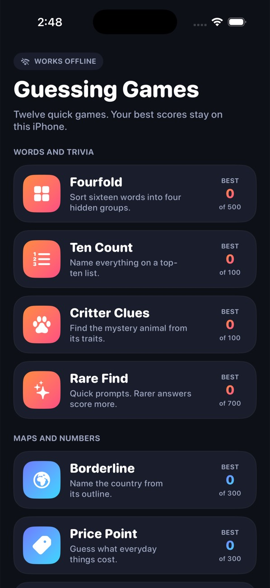
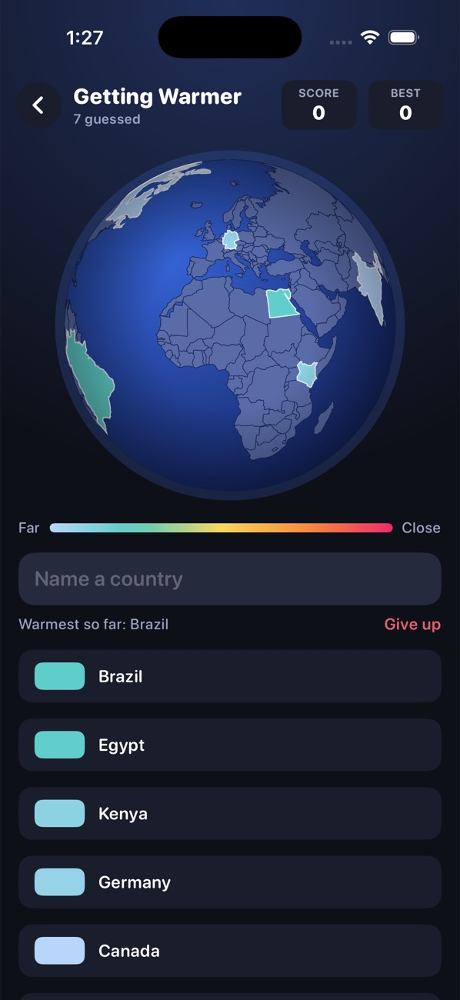
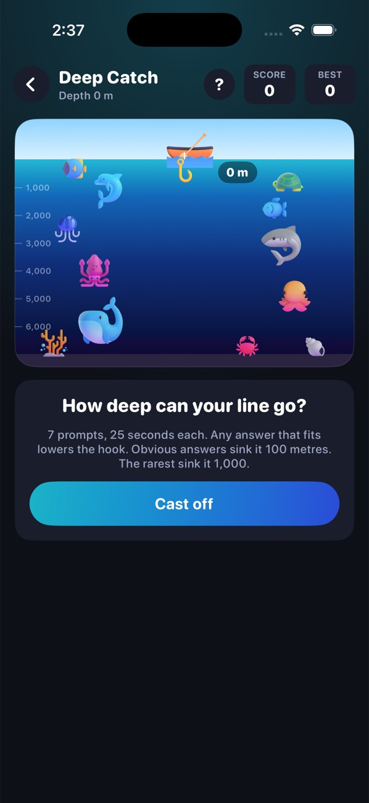
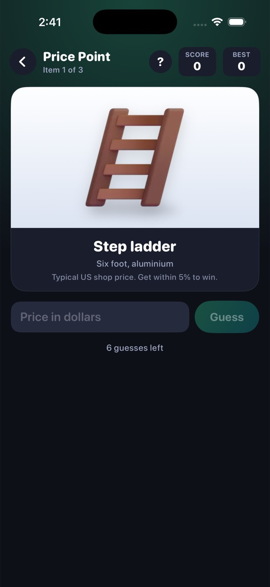
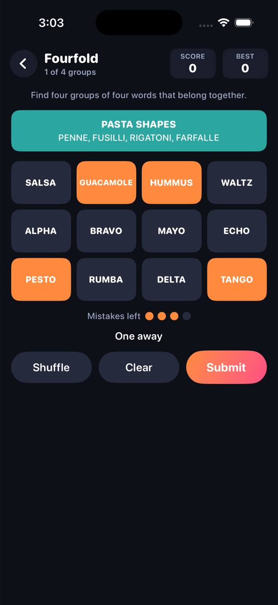
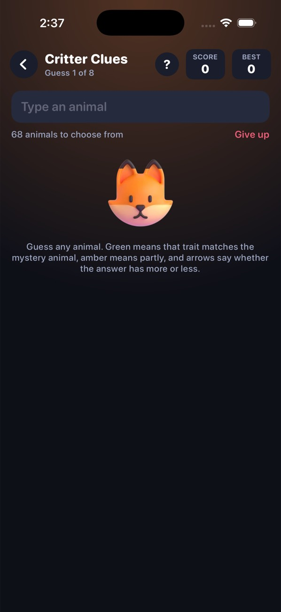
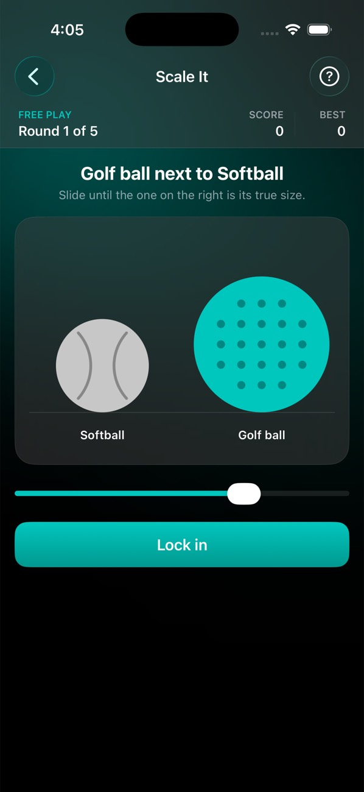
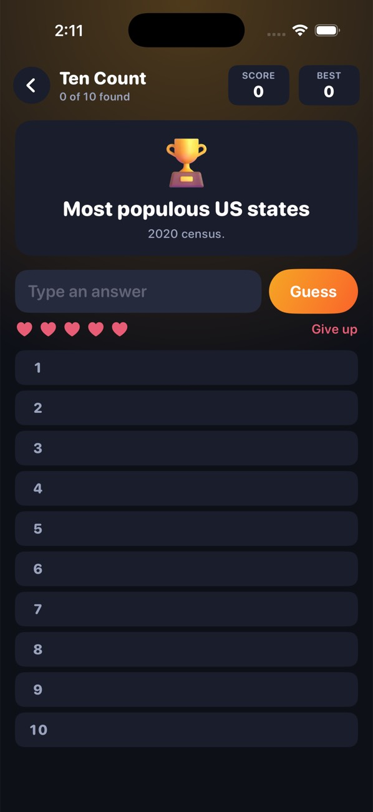

# Offline Guessing Games

An iPhone app with twelve guessing games behind one menu. It is written in
Swift and SwiftUI, needs no network and no accounts, and uses no third-party
code. Every puzzle ships inside the app.

Each game is an original take on a popular style of web guessing game, with
its own name, rules text, look and content. None of them copies the puzzles,
data, images or branding of an existing game.

| | | | |
| --- | --- | --- | --- |
|  |  |  |  |
|  |  |  |  |

These screenshots were taken from the app running in the iOS Simulator.

## The games

| Game | How it plays | One run | Max |
| --- | --- | --- | --- |
| Getting Warmer | A mystery country hides on the globe. Name countries: each lights up, hotter the closer it is. Colour is the only clue. | 1 country | 100 |
| Fourfold | Sort sixteen words into four hidden groups of four. Four mistakes allowed. | 1 puzzle | 500 |
| Ten Count | Name everything on a top-ten list before five wrong guesses. | 1 list | 100 |
| Critter Clues | Find the mystery animal. Each guess shows which traits match. | 1 animal, 8 guesses | 100 |
| Deep Catch | Seven timed "name a ..." prompts. Rarer answers sink your fishing line deeper. A wrong answer costs two seconds. | 7 prompts, 25 seconds each | 700 |
| Price Point | See an everyday item and guess its price, with higher or lower hints. | 3 items, 6 guesses each | 300 |
| Ballpark | Estimate a big number in one guess, with a calculator for the working out. Scored by how many times off you were. | 3 questions | 300 |
| Trendline | The start of a real chart is shown. Draw where the line went next. | 3 charts | 300 |
| Scale It | Two outlines stand side by side. Resize one until the pair looks true to life. | 5 pairs | 500 |
| Hue Recall | Study a colour for three seconds, then pick the same colour from memory. | 5 colours | 500 |
| Pitch Match | Listen to a note, then tune your own note to match. | 5 notes | 500 |
| Beat Keeper | Listen to a beat, then keep it going by tapping. | 5 beats | 500 |

## Around the games

- **How to play.** The question mark in each game's navigation bar opens a
  short guide to that game.
- **Results.** A run ends with a score, one to three stars, and a button to
  share the result as text.
- **Stats.** The chart button at the top of the menu lists best score, games
  played and average for every game, plus the daily streak.
- **Sound and haptics.** Both can be switched off from the "..." button at
  the top of the menu. The notes in Pitch Match and the clicks in Beat Keeper
  always play, since those games need them.

## Look and feel

The app is styled to sit naturally on iOS rather than to look like a game
with its own skin.

- **System pieces first.** The system typeface, the system navigation bar
  (so swiping from the left edge goes back), a segmented control, menus and
  sheets. Game icons are SF Symbols on rounded squares.
- **Materials.** Cards and bars are translucent and pick up a soft wash of
  each game's colour from behind.
- **Motion.** Everything moves on springs, which can be interrupted and
  redirected part-way. Buttons respond the moment a finger lands, not when
  it lifts. Things that appear from below leave the same way. Overshoot is
  kept for moments with momentum behind them, such as a points badge
  popping in.
- **Direct manipulation.** The globe follows the finger exactly, keeps
  turning after a flick and can be caught mid-spin, and pinching zooms it.
  Sliders and the chart follow the finger with no animation in between.
- **Accessibility.** With Reduce Motion on, movement becomes short fades,
  the confetti is skipped and the globe does not coast. With Reduce
  Transparency on, the system makes the materials solid.

## Daily and free play

The switch at the top of the menu chooses between two ways to play.

- **Daily.** Every game has one puzzle per day. It is worked out from the
  date, so it is the same all day and changes at your local midnight. You get
  one go at each. The menu shows how many you have finished today and your
  streak of days in a row.
- **Free play.** As many rounds as you like, dealt from a shuffled deck that
  is remembered between launches, so you see every puzzle once before any
  repeats.

There is no server. "Daily" means the app picks from the puzzles it already
has, so each game's daily puzzles eventually come round again:

| Game | Puzzles in the app | Notes |
| --- | --- | --- |
| Fourfold | 1,000 | 20 hand-written, the rest built from a bank of 97 word categories. Each built puzzle is checked to have exactly one solution. |
| Scale It | 988 pairs | Built from families of things with well-known sizes: planets and moons, balls, landmarks, mountains and animals. |
| Hue Recall, Pitch Match, Beat Keeper | Unlimited | Each round is generated. |
| Ballpark | 188 questions | Three per run. |
| Getting Warmer | 165 countries | |
| Price Point | 122 items | Three per run. |
| Critter Clues | 68 animals | |
| Ten Count | 45 lists | |
| Deep Catch | 39 prompts | Seven per run, so daily prompts repeat after about six days. |
| Trendline | 13 charts | Three per run, so daily charts repeat after about four days. |

The fact-based games are smaller on purpose: they only contain figures that
are well established, and none were invented to pad the numbers. To add more,
edit that game's file in `MiniGameHub/Data/`.

## Run it

Requirements: a Mac with Xcode 15 or later. The app targets iOS 16 and later.

1. Download or clone this repository.
2. Open `MiniGameHub.xcodeproj` in Xcode.
3. Pick an iPhone simulator in the toolbar and press Run (Cmd+R).

To run on a real iPhone, select the `MiniGameHub` target, open
**Signing & Capabilities**, choose your Team, and change the bundle identifier
from `com.example.MiniGameHub` to something of your own.

Pitch Match and Beat Keeper play sound, so turn the volume up for those.

## How it fits together

```
MiniGameHub/
  MiniGameHubApp.swift     App entry point, portrait lock
  Hub/HubView.swift        Menu: Daily / Free play switch, a row per game
  Shared/
    GameKind.swift         The list of games (title, colours, icon)
    GameChrome.swift       Navigation bar, score strip, result card, shared styles
    Theme.swift            Colours, springs and transitions, game icons
    Silhouettes.swift      The outlines drawn in Scale It
    HighScoreStore.swift   Offline best scores
    TonePlayer.swift       Sine tones for the two sound games
    Effects.swift          Confetti, star rating, how-to-play sheet
    Feedback.swift         Sound effects and haptics together
    Haptics.swift
  Logic/                   Rules shared by several games (no screen code)
    Deck.swift             Free-play deck, daily puzzle picking, seeded randomness
    Calculator.swift       The calculator in Ballpark
    TextMatch.swift        Forgiving matching of typed answers
    Geo.swift              Globe maths
    Scoring.swift          Point rules
    Atlas.swift            Reads the country outlines
  Data/                    All puzzle content, one file per game
    WordBank.swift         Word categories and the Fourfold puzzle builder
  Models/                  One engine per game, plus DailyStore
  Games/                   One SwiftUI screen per game
  Assets.xcassets/Art      Pictures of products, animals and sea life
  Assets.xcassets/Silhouettes   Animal outlines for Scale It
Tests/LogicTests/          Command-line checks for the rules and content
Licenses/                  Licence for the pictures
```

**Navigation.** `HubView` holds a `NavigationStack`. Tapping a row pushes that
game's screen in daily mode or free play. Every screen is wrapped in
`GameChrome`, which sets up the navigation bar, the score strip under it and
the result card.

**Engine and screen.** Each game has an engine in `Models/` (an
`ObservableObject` holding the state and rules) and a screen in `Games/` that
only draws that state and passes taps along. The engines do not import SwiftUI,
which is what lets the tests run them from the command line.

**Scores.** `HighScoreStore` keeps one best score per game and `DailyStore`
keeps today's daily results and the streak. Both use `UserDefaults`, which
lives on the device and needs no network.

**Adding a game.** Add a case to `GameKind`, write an engine and a screen, and
add the screen to the `switch` in `HubView`.

## About the content

- **Pictures** of products, animals and sea life come from Microsoft's
  Fluent Emoji set, used under the MIT licence. See
  `Licenses/FluentEmoji-LICENSE.txt`. The seven animal outlines in Scale It
  are traced from the same set. The outlines of landmarks, mountains, balls
  and planets are drawn in code and are simplified shapes, not surveys.
- **Icons** in the interface are Apple's SF Symbols, which ship with iOS.
- **Country outlines** come from Natural Earth (public domain,
  naturalearthdata.com) at 1:110m scale. The game uses the 165 United Nations
  member states present in that data. Far-off overseas territories and very
  small islands are left out of the outlines.
- **Ten Count lists, Ballpark answers, Scale It sizes and Trendline charts**
  are standard reference figures and official statistics. The lists are
  limited to rankings that do not change from year to year.
- **Price Point prices** are rough reference prices for a typical mid-range
  item in a US shop, chosen for the game. They are not live prices and do not
  come from any particular shop. Change them in `Data/PriceItems.swift`.
- **Deep Catch rarity tiers** are the author's estimate of how obvious each
  answer is. Online games of this kind rank answers by what real players
  type, which an offline app cannot do. Change them in
  `Data/RarePrompts.swift`.
- **Fourfold puzzles and Critter Clues animals** were written for this app.

## Testing

Every push to a `claude/**` branch or a pull request runs
`.github/workflows/ios-build.yml` on GitHub, which runs the rule and content
checks and builds the app with Xcode for the iOS Simulator.

What has been checked so far: the app builds with Xcode 26, more than 12,000
rule and content checks pass, and every game, plus the stats, how-to-play,
calculator and result screens and every Scale It outline, was launched in
the iOS Simulator and screenshotted. What has not been checked by the
author: the animations and gestures in motion. Screenshots are still images,
so how the springs, the globe's flick and pinch, and the sound actually feel
has only been judged from the code.

To run the checks yourself from the repository root on a Mac:

```
swiftc -swift-version 5 MiniGameHub/Logic/*.swift MiniGameHub/Data/*.swift \
    MiniGameHub/Models/*.swift Tests/LogicTests/main.swift -o logic-tests
./logic-tests
```

They cover the answer matching, the globe maths, the scoring, daily puzzle
picking, every game engine played through from start to finish, and the
content itself (for example that every built Fourfold puzzle has exactly one
solution, that every accepted spelling in a list resolves to the right entry,
that no two animals look identical to the clue system, and that every picture
named in the data exists).

## Tips

- Launch argument `-startGame globe` (or `fourfold`, `topTen`, `critter`,
  `deep`, `price`, `ballpark`, `trend`, `scale`, `hue`, `pitch`, `beat`) opens
  a game directly in free play. Set it under **Product > Scheme > Edit Scheme >
  Run > Arguments**.
- Stats, the sound and haptics switches and the reset button are behind the
  two buttons at the top right of the menu.
